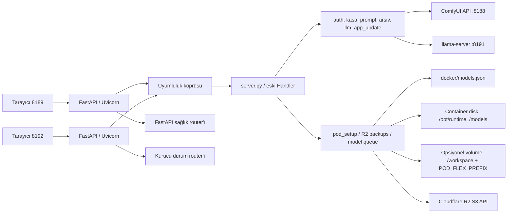
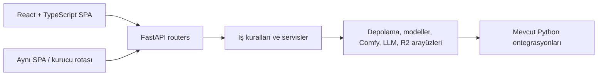

# Mimari: mevcut durum ve hedef

## Şu anki dağıtım



- `docker/Dockerfile.gallery` Ubuntu 24.04 tabanlı küçük uygulama imajı kurar; Python venv ve birkaç Python paketi içerir. `docker/supervisor.py`, WebUI sürecini başlatır ve hazır olma denetimi yapar.
- RunPod'da 8189 ve 8192 aynı process içinde ayrı FastAPI uygulaması/Uvicorn dinleyicisi olarak çalışır. Sağlık uçları (`/api/sunucu-hazir`, `/api/setup-state`) FastAPI router'ına taşınmıştır; diğer API yolları mevcut Handler'a uyumluluk katmanından aktarılır ve response body/header/cookie biçimleri korunur.
- Eski arayüz `index.html` + `static/app.js` + `static/app.css` ile; kurucu `setup.html` + `static/setup.js` + `static/setup.css` ile sunulmaya devam eder. React/TypeScript/Vite uygulaması `/?ui=next` ile açılır. 8189'daki ilk React dilimi hesap/kasa geçidi, geniş üretim alanı, görsel/video seçimi, hazır model seçimi, mobil ayar paneli, iş kuyruğu/ilerleme/iptal ve sonuç gösterimini içerir. Prompt stüdyosu, sohbet, albüm ve kurucu mevcut arayüzde kalır; geçiş sırasında bağlantılar korunur. 8192'de React durumu önizlemesi bulunur, asıl kurucu akışı mevcut kurucu ekranında çalışır. Windows portable `http.server` kullanmaya devam eder.
- `webui_flux2/api/legacy.py` geçiş adaptörüdür. `api/legacy_*_routes.py` dosyaları ana ve kurucu HTTP davranışını kimlik doğrulama, yönetim, medya, kuyruk ve yapay zekâ ailelerine ayırır; mevcut Handler JSON/HTTP sözleşmesi için geçici uyumluluk sınırı olmaya devam eder. Yeni uçlar native `APIRouter`/service sınırına eklenmeli, eski uçlar API contract testleriyle taşınmalıdır. Büyük gövde/yanıtlar belleğe tamamen alınmadan disk tabanlı geçici dosyaya akıtılır; başlık tekrarları (özellikle Set-Cookie) korunur.
- Backend iş kuralları da ayrıştırılmaya başladı: `services/` üretim, kuyruk, içerik ve medya/video yükseltme işlerini; `kasa_modules/` hesap, kripto, yedek ve kasa akışlarını; `llm_runtime/` motor, metin hazırlama, metrik ve aktarımı; `pod_setup_modules/` katalog, indirme, kurulum, ayar ve depolamayı barındırır. `server.py`, `kasa.py`, `llm.py` ve `pod_setup.py` mevcut çağrılar için uyumluluk/facade katmanı olarak tutulur. Bu yüzden geçiş henüz bağımsız domain/adapter mimarisine tamamen ulaşmış değildir.
- `docker/models.json` şema 2, model grupları, dosya indirme kaynakları, bağımlılıklar ve workflow profillerinin tek katalog kaynağıdır.
- İmaj, ComfyUI ve llama-server runtime’ını imaj içine sabitlemez; kurucu runtime/model kaynaklarını çalışma sırasında container diskine yerleştirir. Tam yollar için kaynak varsayılanlarına bakın.
- `app_update.py`, izin listesindeki Python/legacy statik kaynakları ve kataloğu stage/backup/health-check/rollback çevrimiyle günceller. React kaynakları Docker'ın Node aşamasında `frontend-dist/` biçiminde derlendiği için React değişikliği yeni GitHub Actions imajı gerektirir. `Dockerfile.gallery` ve supervisor taban imajla aynı kalmalıdır; bu sınır değişirse yeni Pod/imaj gerekir.

## Ekran/işlev haritası

| Yüzey | Ana bölümler ve API sorumluluğu |
| --- | --- |
| 8189 ana WebUI | React ilk dilimi: ilk kurulum/giriş/kasa açma ve görsel/video üretimi. Eski arayüz: prompt stüdyosu ve sırası; sohbet; arşiv/kütüphane; sistem/iş logları; kullanıcı ve genel ayarlar |
| 8192 kurucu | React ilk dilimi: servis/depolama durumu. Eski kurucu: model listesi/indirme kuyruğu ve işlem kontrolü; model bağlantıları/LoRA ve sistem ayarları; loglar; yedekleme/R2; depolama temizliği, restart ve imaj güncelleme |

Eski ekranların uçları ve payload’ları `server.py`, `static/app.js` ve `static/setup.js` içinde tanımlıdır. Yeni React üretim akışı bu mevcut JSON sözleşmelerini `frontend/src/lib/api/client.ts` üzerinden kullanır. Taşıma sırasında sözleşmeler envanterlenip API testiyle kilitlenmelidir; UI metinlerinden yeni API şeması varsayılmamalıdır.

## Hedeflenen ayrıştırma — geçiş sürüyor



Taşıma önce JSON sözleşmesini koruyan uyumluluk katmanıyla başladı. Python servisleri ayrıştırıldı ve route aileleri ayrı modüllere alındı; FastAPI uygulaması henüz legacy Handler'ı çağıran köprüdür. React üretim ekranı çalışan bir ilk dilimdir; kalan ekranlar özellik bazında taşınacaktır. Her dilim API/auth/CSRF/iptal/ilerleme testlerinden geçtikten sonra aktif olmalıdır. JSON sözleşmesi, kullanıcı verisi, queue cancellation, upload progress, canlı log ve setup portunun bağımsız açılma özelliği korunmalıdır. FastAPI'nin [çok dosyalı uygulama/router](https://fastapi.tiangolo.com/tutorial/bigger-applications/) ve [lifespan](https://fastapi.tiangolo.com/advanced/events/) belgeleri yeni router ve servis yaşam döngüsü için başlangıç kaynağıdır.

Önerilen gelecek paket yapısı:

```text
webui_flux2/
  api/                 # FastAPI app, router ve şema
  services/            # üretim, prompt, kuyruk, model yönetimi
  domain/              # veri tipleri ve iş kuralları
  adapters/            # ComfyUI, llama-server, disk, R2
  frontend/            # Vite/React/TypeScript uygulaması
    src/app/            # route/layout ve erişim sınırları
    src/features/       # production, prompt-studio, chat, archive, setup...
    src/components/     # paylaşılan UI bileşenleri
    src/lib/api/         # tipli HTTP istemcisi ve hata eşleme
  tests/               # API sözleşmesi, servis ve UI akışları
```

Kademeli geçişin ADR’leri `docs/decisions/` içindedir.
