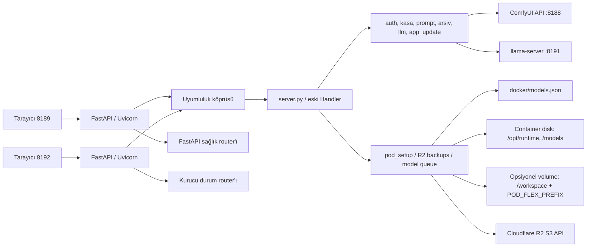
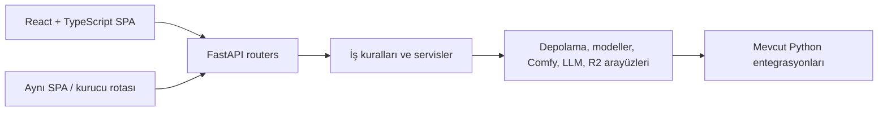

# Mimari: mevcut durum ve hedef

## Şu anki dağıtım



- `docker/Dockerfile.gallery` Ubuntu 24.04 tabanlı küçük uygulama imajı kurar; Python venv ve birkaç Python paketi içerir. `docker/supervisor.py`, WebUI sürecini başlatır ve hazır olma denetimi yapar.
- RunPod'da 8189 ve 8192 aynı process içinde ayrı FastAPI uygulaması/Uvicorn dinleyicisi olarak çalışır. Sağlık uçları (`/api/sunucu-hazir`, `/api/setup-state`) FastAPI router'ına taşınmıştır; diğer API yolları mevcut Handler'a uyumluluk katmanından aktarılır ve response body/header/cookie biçimleri korunur.
- React/TypeScript/Vite uygulaması RunPod'da hem 8189 hem 8192 için varsayılandır. 8189'da ana çalışma alanı, 8192'de kurucu bölümleri aynı React bundle'ında açılır. `/?ui=legacy` ve `:8192/?ui=legacy` eski 8189 arayüzüne ve eski 8192 kurucusuna geri dönüş sağlar; `/?ui=next` React uygulamasını doğrudan açar. Windows portable `http.server` ve eski arayüz varsayılanı korunur.
- `webui_flux2/api/legacy.py` geçiş adaptörüdür. `api/legacy_*_routes.py` dosyaları ana ve kurucu HTTP davranışını kimlik doğrulama, yönetim, medya, kuyruk ve yapay zekâ ailelerine ayırır; mevcut Handler JSON/HTTP sözleşmesi için geçici uyumluluk sınırı olmaya devam eder. Yeni uçlar native `APIRouter`/service sınırına eklenmeli, eski uçlar API contract testleriyle taşınmalıdır. Büyük gövde/yanıtlar belleğe tamamen alınmadan disk tabanlı geçici dosyaya akıtılır; başlık tekrarları (özellikle Set-Cookie) korunur.
- Backend iş kuralları da ayrıştırılmaya başladı: `services/` üretim, kuyruk, içerik ve medya/video yükseltme işlerini; `kasa_modules/` hesap, kripto, yedek ve kasa akışlarını; `llm_runtime/` motor, metin hazırlama, metrik ve aktarımı; `pod_setup_modules/` katalog, indirme, kurulum, ayar ve depolamayı barındırır. `server.py`, `kasa.py`, `llm.py` ve `pod_setup.py` mevcut çağrılar için uyumluluk/facade katmanı olarak tutulur. Bu yüzden geçiş henüz bağımsız domain/adapter mimarisine tamamen ulaşmış değildir.
- `docker/models.json` şema 2, model grupları, dosya indirme kaynakları, bağımlılıklar ve workflow profillerinin tek katalog kaynağıdır.
- İmaj, ComfyUI ve llama-server runtime’ını imaj içine sabitlemez; kurucu runtime/model kaynaklarını çalışma sırasında container diskine yerleştirir. Tam yollar için kaynak varsayılanlarına bakın.
- `app_update.py`, izin listesindeki Python/legacy statik kaynakları ve kataloğu stage/backup/health-check/rollback çevrimiyle günceller. React kaynakları Docker'ın Node aşamasında `frontend-dist/` biçiminde derlendiği için React değişikliği yeni GitHub Actions imajı gerektirir. `Dockerfile.gallery` ve supervisor taban imajla aynı kalmalıdır; bu sınır değişirse yeni Pod/imaj gerekir.

## Ekran/işlev haritası

| Yüzey | Ana bölümler ve API sorumluluğu |
| --- | --- |
| 8189 ana WebUI | React: ilk kurulum/giriş/kasa; üretim; Prompt Stüdyosu/geçmişi; sohbet; sıra; kütüphane/arşiv; izleme; ayarlar ve kullanıcı yönetimi |
| 8192 kurucu | React: model indirme kuyruğu ve işlem kontrolü; kurucu/genel ayarlar; yedekleme; sistem/bakım ve loglar |

Eski ekranların uçları ve payload’ları `server.py`, `static/app.js` ve `static/setup.js` içinde tanımlıdır. React ekranları aynı API'lere `frontend/src/lib/api/client.ts` üzerinden bağlanır. API ve servis davranışlarının çoğu legacy Handler uyumluluk köprüsünden geçmeye devam eder. Taşıma sırasında sözleşmeler envanterlenip API testiyle kilitlenmelidir; UI metinlerinden yeni API şeması varsayılmamalıdır.

### React taşıma durumu

- 8189 ve 8192 portlarında kök adres React’i açar. `/?ui=legacy` eski ana ekranı, `:8192/?ui=legacy` eski kurucuyu açar. İki istemci aynı API, oturum, kasa ve kayıtları kullanır.
- Arayüz `frontend/src/features/` altında üretim/üretim ayarları, prompt stüdyosu, sohbet, galeri/arşiv, sıra/izleme, kullanıcı ayarları ve kurucu modüllerine ayrılmıştır. Üretim isteği mevcut `formVerisi()` alanlarını taşır; kurucu model ekleme, isteğe bağlı MTP/mmproj bileşenleri, yedek devam anahtarı ve uygulama güncelleme/yeniden başlatma durumlarını yönetir.
- React bundle’ı Docker Node aşamasında derlenir ve imaja `frontend-dist/` olarak kopyalanır. Bu nedenle kaynakta React değişikliği yeni Actions imajı gerektirir; uygulama içindeki Python dosya güncellemesi bundle’ı değiştirmez.
- Otomatik doğrulama sentetik istemci verisiyle çalışır. Bu taşıma diliminde React tarafında 31 test, backend/API tarafında 40 test geçti; Python derlemesi, eski JavaScript syntax kontrolleri ve Vite üretim derlemesi de doğrulandı. React testleri tek işçiyle çalışır; düşük kaynaklı makinelerde paralel testlerin zaman aşımına uğramasını önler.
- Bu dilimde React ekranlarına kaydedilmiş prompt ve ayarları uygulama, sohbetten görsel/prompt aktarma, devam eden işlere yeniden bağlanma, albümler arasında görsel gezme, geçmiş kaydını silme/görünümü kaydetme, kurucu indirme sırasını düzenleme ve bağlantıyı varsayılana döndürme davranışları eklendi. JSON istekleri mevcut legacy API sözleşmelerini kullanır.
- Görsel ve mobil son değerlendirme kullanıcıyla daha sonra yapılacak toplu inceleme için ertelendi. CI ve geçici CPU Beta Pod kontrolünde volume olmadan 8189/8192 React girişleri ve sağlık uçları açıldı; ilk kurulum temiz/ephemeral kaldı. Bu kontroller GPU üretimini veya tüm mobil görsel davranışını kanıtlamaz.
- API uygulaması henüz bütünüyle FastAPI route/service mimarisine taşınmadı; legacy Handler uyumluluk köprüsü endpoint’lerin çoğunda duruyor. React geçişi backend’i bu köprüden çıkarmış sayılmaz.

## Hedeflenen ayrıştırma — geçiş sürüyor



Taşıma önce JSON sözleşmesini koruyan uyumluluk katmanıyla başladı. Python servisleri ayrıştırıldı, route aileleri ayrı modüllere alındı ve RunPod ekranları React’e taşındı; FastAPI uygulaması hâlen legacy Handler’ı çağıran köprüdür. Sonraki backend işi bu köprüyü alan alan native router/service sınırına taşımaktır. JSON sözleşmesi, kullanıcı verisi, queue cancellation, upload progress, canlı log ve setup portunun bağımsız açılma özelliği korunmalıdır. FastAPI'nin [çok dosyalı uygulama/router](https://fastapi.tiangolo.com/tutorial/bigger-applications/) ve [lifespan](https://fastapi.tiangolo.com/advanced/events/) belgeleri yeni router ve servis yaşam döngüsü için başlangıç kaynağıdır.

Önerilen gelecek paket yapısı:

```text
webui_flux2/
  api/                 # FastAPI app, router ve şema
  services/            # üretim, prompt, kuyruk, model yönetimi
  domain/              # veri tipleri ve iş kuralları
  adapters/            # ComfyUI, llama-server, disk, R2
  frontend/            # Vite/React/TypeScript uygulaması
    src/app/            # route/layout ve erişim sınırları
    src/features/       # production, prompt-studio, chat, archive, setup...
    src/components/     # paylaşılan UI bileşenleri
    src/lib/api/         # tipli HTTP istemcisi ve hata eşleme
  tests/               # API sözleşmesi, servis ve UI akışları
```

Kademeli geçişin ADR’leri `docs/decisions/` içindedir.
